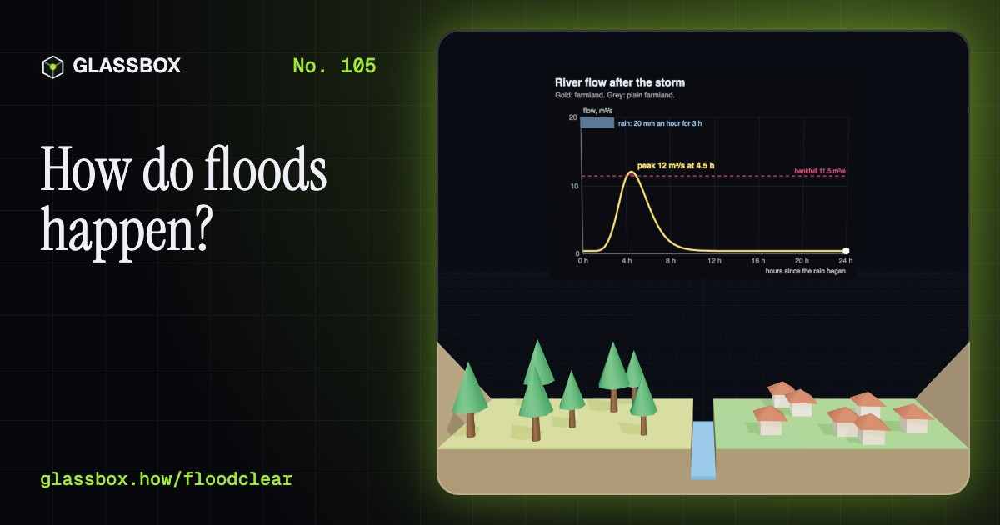
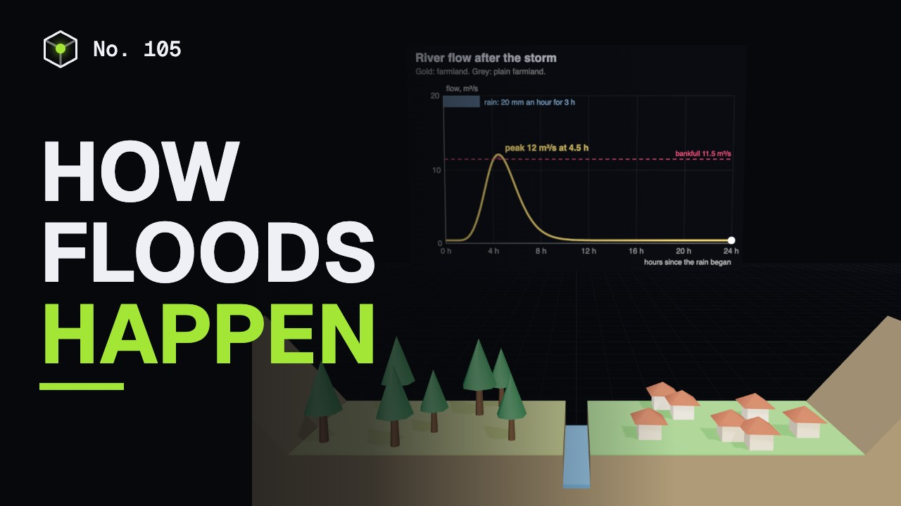
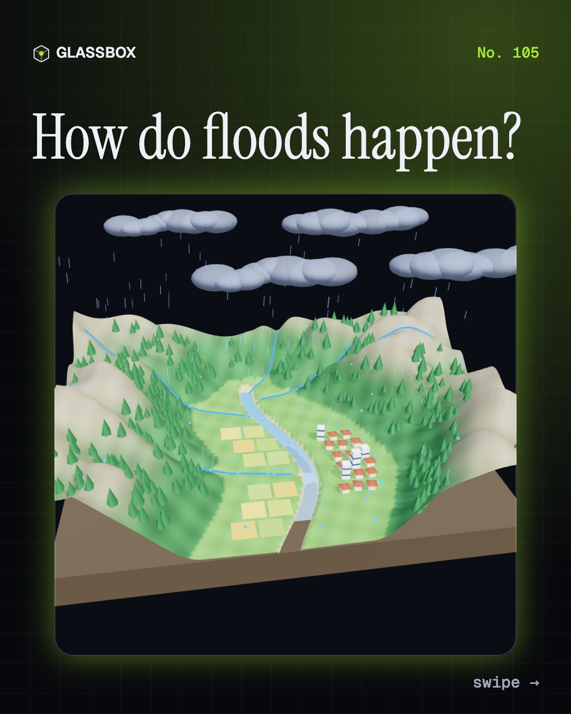
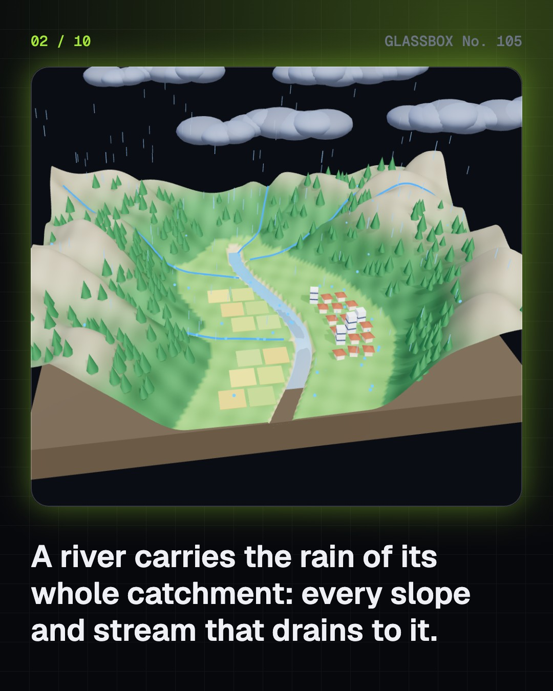
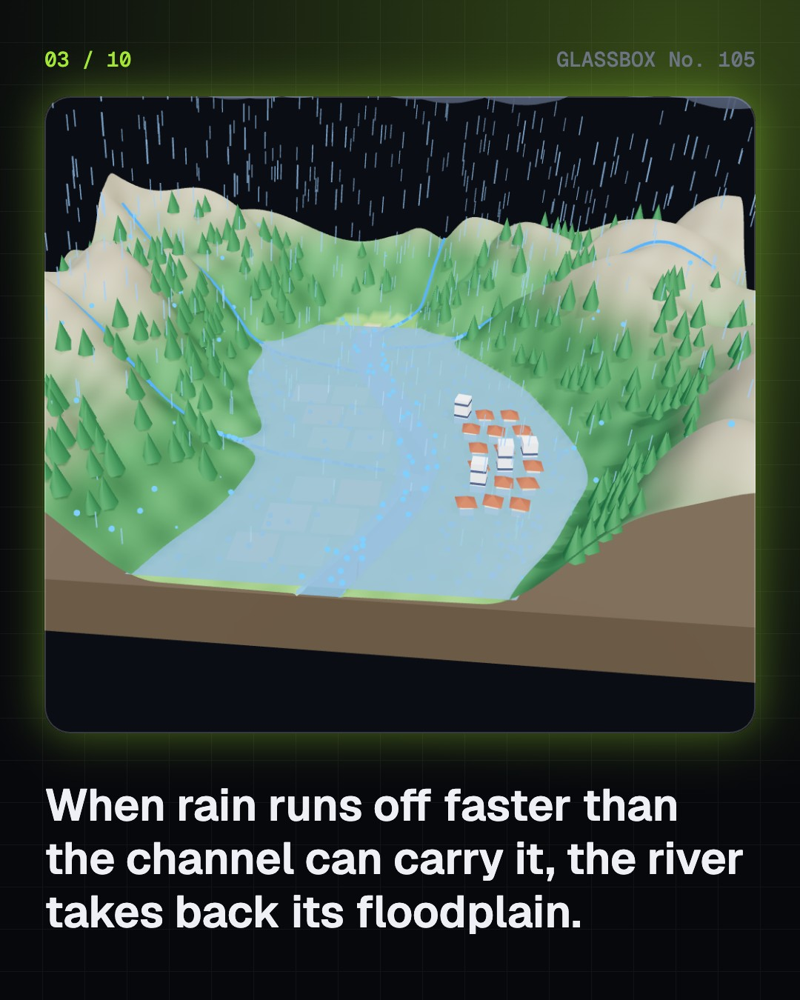
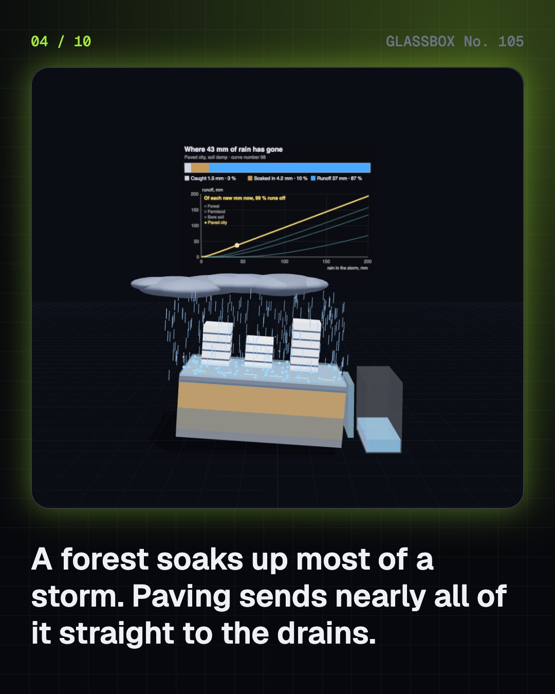

<!-- glassbox:start -->
<!-- Generated from glassbox.json by the Glassbox hub (npm run readme -- floodclear). Edit glassbox.json, not this block. -->
<p align="center"><a href="https://glassbox.how/e/floodclear/"></a></p>

<h1 align="center">FloodClear</h1>

<p align="center"><b>How do floods happen?</b><br>A flood is water arriving faster than it can leave. Pour rain on a 3D valley, see how forest, farmland and paving split it between soaking in and running off, drive a river's hydrograph over its banks, and work out live why a "100-year flood" has a one in four chance of reaching you in 30 years.</p>

<p align="center"><a href="https://glassbox.how/floodclear/"><b>▶ Play with it</b></a> &nbsp;·&nbsp; <a href="https://glassbox.how/e/floodclear/">Read the 60-second explainer</a> &nbsp;·&nbsp; <a href="https://glassbox.how/floodclear/glassbox/reel.mp4">Watch the 40-second video</a></p>

<p align="center">
  <a href="https://glassbox.how/e/floodclear/"></a>
  <a href="https://glassbox.how/e/floodclear/"></a>
  <a href="LICENSE"></a>
  <a href="LICENSE-CONTENT.md"></a>
  <a href="#privacy"></a>
</p>

## In 60 seconds

1. **A river and its valley.** A catchment is all the land that slopes to one river. Rain that lands on it soaks in, evaporates or runs off, and the runoff gathers through streams into a single channel. That channel only fits the flow of an ordinary year. In bigger floods the river spreads over its floodplain, the flat land it built from its own silt.
2. **Where the rain goes.** Rain in equals water caught, water soaked in and runoff. The split depends on the surface and on how wet the soil already is. In the model a 60 mm storm on damp forest sends about 2 mm to the river. The same storm on paving sends about 54 mm. Soaked soil behaves more like paving, which is why late-monsoon rain floods.
3. **The river's pulse.** After a storm a river rises to a peak and falls: its hydrograph. The peak lags the rain because water takes time to travel. Paving, cleared slopes and straightened channels send more water, sooner, so the peak is higher and earlier. Forests, wetlands and reservoirs hold water back and flatten it. The river spills when flow passes bankfull.
4. **Six kinds of flood.** River floods rise over days. Flash floods and cloudbursts (100 mm or more in an hour, by IMD's definition) arrive in minutes to hours. Urban floods come when rain beats the drains. Coastal floods are storm surge. Glacial lake outburst floods and breaches of dams or embankments release stored water at once. The faster the flood, the shorter the warning.
5. **Odds and defences.** A 100-year flood has a 1 % chance each year, which adds up to about 26 % over 30 years. Embankments hold ordinary floods but squeeze the river higher and fail suddenly when overtopped. Reservoirs help while they have room. Giving the river space, keeping wetlands and warning people early all cut the harm.
6. **India and staying safe.** India gets most of its rain in four monsoon months. IMD warns of heavy rain and the Central Water Commission has forecast river levels since 1958. Move to higher ground early, switch off electricity, and never walk or drive through moving water: 15 cm can knock you down and about 30 cm can carry off a small car. Afterwards, drink boiled or chlorinated water. Call 112.

## Words worth knowing

| Term | Meaning |
|---|---|
| **Catchment** | All the land that drains to one river. Also called a river basin or watershed. |
| **Runoff** | Rain that flows over the ground instead of soaking in. It is the part that makes floods. |
| **Infiltration** | Water soaking down into the soil. Paving stops it; saturated soil has no room for it. |
| **Floodplain** | The flat land beside a river that the river covers when it floods, built from silt left by past floods. |
| **Hydrograph** | A graph of a river's flow against time. After a storm it rises to a peak and falls. |
| **Bankfull** | The flow that just fills a river's channel. Above it the river spills onto its floodplain. |
| **Return period** | How rare a flood is. A 100-year flood has a 1 % chance of being reached in any one year. |
| **Embankment** | An earth wall along a river, also called a bund or levee. It holds ordinary floods but can fail suddenly in a rare one. |
| **GLOF** | Glacial lake outburst flood: the sudden emptying of a meltwater lake held back by ice or loose moraine. |

## A short history

**From marks on a stone beside the Nile to forecasts that tell a town how high the river will be tomorrow.**

- **2400 BCE** · Egypt writes down the height of the Nile flood (Royal scribes of the Old Kingdom, Memphis, Egypt)
- **1887** · The Yellow River bursts its dykes (People of Henan and the plains beyond, Near Zhengzhou, Henan)
- **1889** · The Johnstown flood (People of Johnstown; the South Fork Dam, Johnstown, Pennsylvania)
- **1927** · The Great Mississippi Flood (People of the lower Mississippi valley, Mississippi valley)
- **1932** · The unit hydrograph (Leroy K. Sherman, Chicago)
- **1953** · The North Sea flood and the Delta Works (People of Zeeland and South Holland, South-west Netherlands)
- **1958** · India begins flood forecasting (Central Water Commission, Old Railway Bridge, Delhi)
- **1979** · The Machchhu dam failure at Morbi (People of Morbi, Morbi, Gujarat)

The full story, with 30 moments, charts, people and 49 sources: [glassbox.how/e/floodclear/history](https://glassbox.how/e/floodclear/history/). The data lives in [`history.json`](history.json).

## Video and slides

Made with the Glassbox studio from this box's storyboard (`window.glassbox.director`). Free to reuse under CC BY 4.0.

<a href="https://glassbox.how/floodclear/glassbox/video.mp4"></a>

<p><a href="glassbox/slide-1.jpg"></a> <a href="glassbox/slide-2.jpg"></a> <a href="glassbox/slide-3.jpg"></a> <a href="glassbox/slide-4.jpg"></a></p>

| File | What | Size |
|---|---|---|
| [`glassbox/reel.mp4`](https://glassbox.how/floodclear/glassbox/reel.mp4) | Reel / Short, with captions and soundtrack | 1080×1920 |
| [`glassbox/video.mp4`](https://glassbox.how/floodclear/glassbox/video.mp4) | YouTube video, with captions and soundtrack | 1920×1080 |
| `glassbox/slide-1…10.jpg` | Instagram carousel | 1080×1350 |
| `glassbox/thumb.jpg` | YouTube thumbnail | 1280×720 |
| `glassbox/cover.jpg` | Share card and repo social preview | 1200×630 |
| [`glassbox/history-reel.mp4`](https://glassbox.how/floodclear/glassbox/history-reel.mp4) | “History in 10 moments” Reel / Short | 1080×1920 |
| `glassbox/history-slide-*.jpg` | History carousel | 1080×1350 |
| `glassbox/post.json` | Post copy and schedule used by the publish kit | |

## Privacy

This box has no accounts and no ads, and it ships its own fonts and libraries. When you run it yourself it sends nothing anywhere. On glassbox.how, the site's `/bar.js` also loads Glassbox's analytics: **Google Analytics** to count visits (it asks first in the EU, UK and Switzerland, and stays off when your browser sends Global Privacy Control or Do Not Track) and **ClickTrust** to detect bots.

It remembers a few things **in your own browser only**, and never sends them anywhere:

| Browser storage key | What it holds |
|---|---|
| `floodclear.v1` | Which chapters you have opened, your best quiz scores, and sound on or off. |

Exactly what each one sees is at [glassbox.how/privacy](https://glassbox.how/privacy/).

## Licences

- **Code:** [MIT](LICENSE). Use it, change it, ship it.
- **Explanations, text, images and videos** (`glassbox.json`, `glassbox/`): [CC BY 4.0](LICENSE-CONTENT.md). Credit “Glassbox, glassbox.how/e/floodclear”.
- **Third-party parts** keep their own licences: [three.js](https://threejs.org) (MIT), [Geist, Instrument Serif](https://openfontlicense.org) (SIL OFL 1.1).
- The Glassbox name and logo aren't covered by either licence. See the [terms](https://glassbox.how/terms/).

Found a mistake? [Open an issue](https://github.com/bdeeps/floodclear/issues). Corrections happen in public.
<!-- glassbox:end -->

## Run it

It's plain HTML, CSS and JavaScript. No build step and no dependencies. Run locally, it contacts no other website.

```bash
python3 -m http.server 8000
```

Three.js and the fonts ship in `vendor/` and `fonts/`, so it also works offline.

Then open http://localhost:8000.

## How it's built

| File | What |
|---|---|
| `index.html`, `css/app.css` | The page and its styles |
| `js/app.js`, `js/stage.js`, `js/ui.js`, `js/kit.js` | The shared Glassbox 3D engine: chapters, 3D stage, controls, quiz, video director |
| `js/flood.js` | FloodClear's shared hydrology (curve-number runoff, unit hydrograph, Manning's equation, Gumbel flood odds, the push of moving water) and scene helpers |
| `js/chapters/*.js` | One file per chapter: the 3D model, controls, text, key terms, quiz and video scenes |
| `glassbox.json` | Title, question, explainer beats, key terms, browser storage and credits shown on glassbox.how |
| `reel` in each chapter | The storyboard the Glassbox studio records into short videos |
| `glassbox/` | The published video, slides, thumbnail and post copy |
| `fonts/`, `vendor/three/` | Self-hosted Geist and Instrument Serif (SIL OFL 1.1) and three.js (MIT) |
